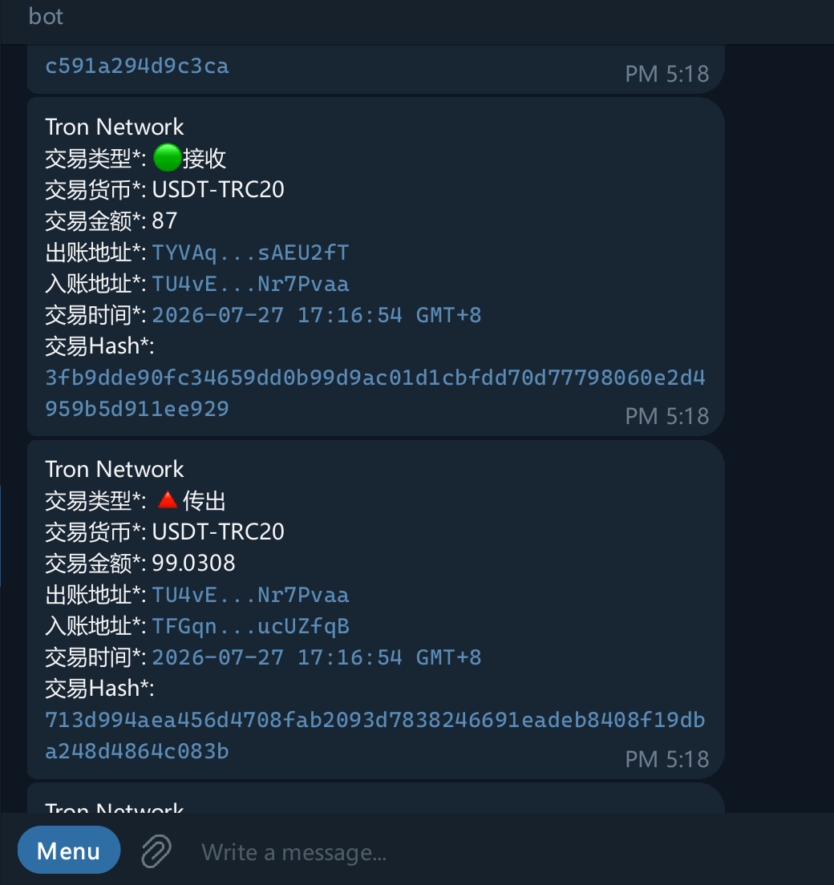

# Wallet-Flow-Bot

Send a notification via Telegram Bot when the wallet transfers USDT.

## 支持的区块链网络

- TRX/USDT on <https://tron.network/>

- USDT on <https://polygon.technology/>

## 构建

### 安装依赖

以apt为例

```shell
apt install -y build-essential pkg-config libssl-dev zlib1g-dev
```

### 执行构建脚本

```shell
bash ./build.sh
```

## 配置文件

配置文件为config.json

```json
{
    "rpc_url": "https://api.trongrid.io",
    "api_key": "",
    "target_address": "Your_Tron_address", // Tron地址(b58格式"T...")
    "bot_token": "bot_token_here", // bot token
    "admin_id": "", //Telegram ID
    "polygon_rpc_url": "https://polygon.drpc.org", //需要Polygon Json-API地址， 若不填则disable该功能
    "polygon_wss_url": "wss://polygon-bor-rpc.publicnode.com", //Polygon WSS
    "polygon_monitor_addresses": "0xe7_your_address" //POL地址
}
```

- api_key: trongrid的Key

- polygon_rpc_url：Polygon json API 地址

- polygon_wss_url：Polygon WSS 地址

## 运行命令

运行参数 `--c ./config.json`

## Systemd

检查 `wallet-flow-bot.service` 文件

## 运行要求

- CPU: 1v Core
- RAM: 1 GB
- Disk Space: 5 GB

## 注意事项

长轮询区块链网络，不可避免的需要消耗流量数据

当前版本支持TRON,POL两个网络大约需要**数据流量 45GB/月(下行)**

## Preview


